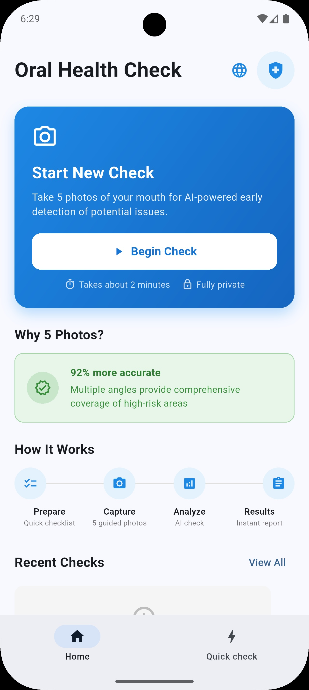
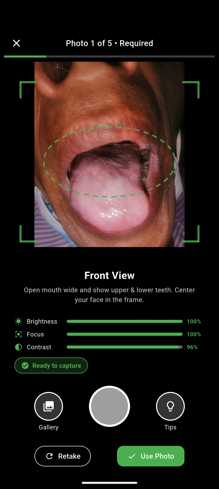
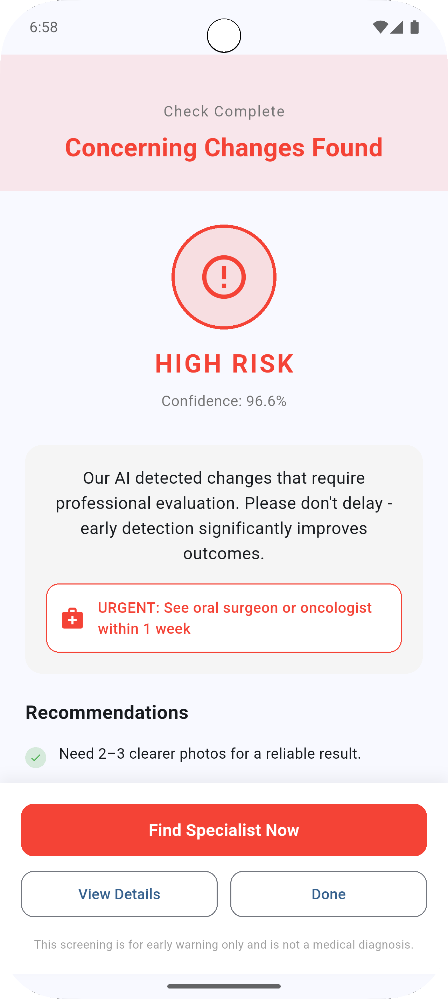
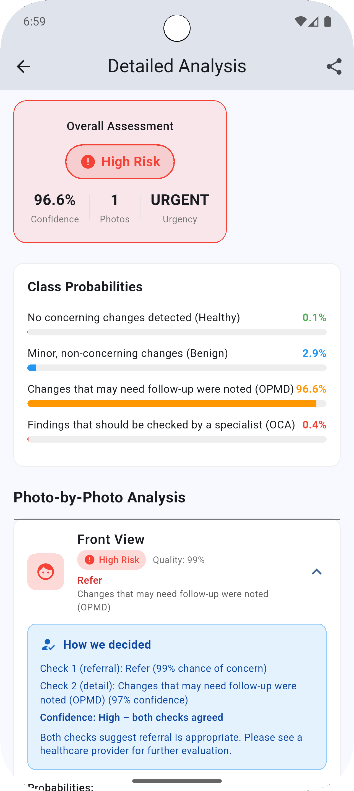
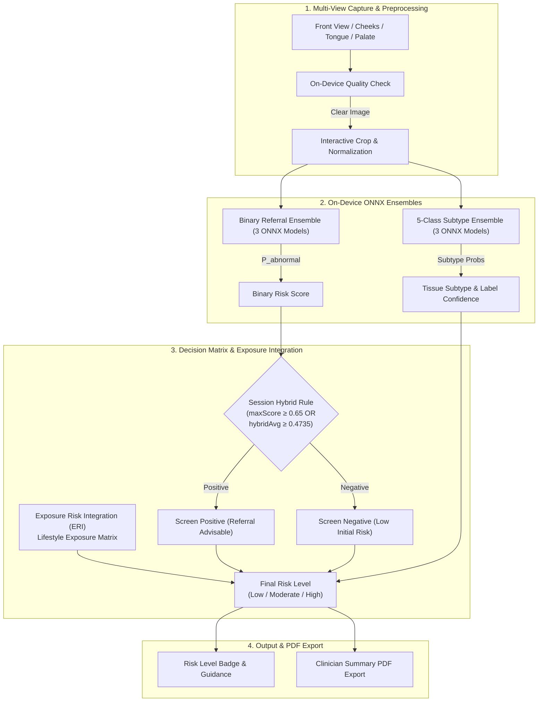

# Oral Check Assist (Oral Cavity Classifier)

[](https://flutter.dev)
[](https://onnxruntime.ai/)
[](https://python.org)
[](LICENSE)
[]()

**Oral Check Assist** is a cross-platform mobile and web application (Android, iOS, PWA) for **AI-assisted oral cavity screening** from smartphone photos. It produces risk-stratified guidance on whether specialist clinical follow-up may be advisable — particularly for populations with tobacco or alcohol exposure history.

> [!IMPORTANT]
> **Clinical Disclaimer:** This application is an **initial screening aid, not a diagnostic device**. It does not diagnose oral cancer or any disease. All clinical decisions belong strictly to qualified healthcare professionals.

---

## 📱 Application Overview & Screenshots

| Home & Session Start | Guided Capture & Quality Check |
| :---: | :---: |
|  |  |
| **Screening Results** | **Per-Photo Analysis Breakdown** |
|  |  |

---

## ✨ Key Features

- **Multi-View Photo Screening Session:** Guided photo capture sequence covering key anatomical slots (Front view, Left/Right cheeks, Tongue, Palate).
- **On-Device Dual Ensemble ML Engine:** Runs 6 ONNX models locally (3 binary referral models + 3 five-class lesion subtype models) with zero network dependency.
- **Real-Time Quality Checks:** Automatic image quality assessment and framing/retake prompts prior to inference.
- **Exposure Risk Integration (ERI):** Optional questionnaire evaluating lifestyle risk factors (tobacco/alcohol exposure) combined with AI signals.
- **Clinician Documentation:** Detailed per-photo breakdown and offline summary PDF report generation for clinical handoff.
- **Cross-Platform & Localized:** Multi-language support (English, Hindi) running natively on Android, iOS, and Web browsers.

---

## 🏗️ System Architecture & Decision Flow



---

## 💡 Engineering Highlights

- **100% Offline Edge AI:** Uses native ONNX Runtime bindings to execute dual ensemble neural networks on-device in real-time without uploading sensitive patient photos to cloud servers.
- **Zero Patient Data Leakage:** ML pipelines enforce strict **patient-wise dataset partitioning** across all cross-validation folds, preventing data contamination between training, validation, and holdout test sets.
- **Binary-Primary Screening Policy:** Binary referral models set the screen-positive operating point ($P_{\text{abnormal}} \ge 0.4735$), while 5-class subtype models supply informational context without overriding referral decisions.
- **SSL Backbone Fine-Tuning:** Neural network backbones are pre-trained via Self-Supervised Learning (SSL) on oral lesion representations prior to full fine-tuning.

---

## 🚀 Quick Start

### Prerequisites

- [Flutter SDK](https://docs.flutter.dev/get-started/install) (stable release; see `pubspec.yaml`)
- [Git LFS](https://git-lfs.com) — **Required** to fetch ONNX model weights stored in `assets/`
- Platform Tooling: Android Studio (Android), Xcode (iOS), or Chrome (Web)

### Clone & Run

```bash
# 1. Install Git LFS and clone repository
git lfs install
git clone https://github.com/3amwave/oral-cavity-classifier.git
cd oral-cavity-classifier

# 2. Pull ONNX model assets via LFS
git lfs pull

# 3. Verify ONNX model files are non-stub binaries
bash scripts/verify_model_assets.sh

# 4. Install dependencies and launch application
flutter pub get
flutter run
```

*To launch web version locally:* `flutter run -d web-server`  
*To run tests & linters:* `flutter test` && `flutter analyze`

---

## 📂 Production ML Model Assets

Production model weights live under `assets/` (managed via Git LFS):

| Asset Pattern | Role | Description |
| :--- | :--- | :--- |
| `binary_ensemble_mode_{1,2,3}.onnx` | Referral Decision | Primary binary ensemble predicting $P(\text{abnormal})$ |
| `ensemble_model_{1,2,3}.onnx` | Subtype Context | 5-class ensemble (Healthy, Benign, OPMD, OCA, Unknown) |

*Training dataset locations, public benchmarks, and reproducible notebooks are documented in [docs/MODEL_DEVELOPMENT_AND_USAGE.md](docs/MODEL_DEVELOPMENT_AND_USAGE.md).*

---

## 📖 Comprehensive Documentation Index

| Guide | Target Audience | Primary Focus |
| :--- | :--- | :--- |
| 📘 [docs/APP_CLINICIAN_GUIDE.md](docs/APP_CLINICIAN_GUIDE.md) | Clinicians & Field Operators | Screening workflows, ERI matrix & interpretation |
| 🔬 [docs/MODEL_DEVELOPMENT_AND_USAGE.md](docs/MODEL_DEVELOPMENT_AND_USAGE.md) | ML Engineers | Canonical model architectures, training & export |
| 📊 [docs/PATIENTWISE_MODEL_DEVELOPMENT.md](docs/PATIENTWISE_MODEL_DEVELOPMENT.md) | Researchers | Patient-wise dataset split methodology & metrics |
| 🧬 [docs/SSL_BACKBONE_MODELS_CREATION_AND_USAGE.md](docs/SSL_BACKBONE_MODELS_CREATION_AND_USAGE.md) | ML Engineers | Self-Supervised Learning (SSL) pre-training |
| 🌐 [docs/TRAINING_DATASET_LOCATIONS.md](docs/TRAINING_DATASET_LOCATIONS.md) | Contributors | Dataset URLs & local root configurations |
| ⚖️ [docs/BINARY_PRIMARY_RISK_GRADING.md](docs/BINARY_PRIMARY_RISK_GRADING.md) | Clinicians & Developers | Binary threshold rules & decision matrices |
| 🤝 [CONTRIBUTING.md](CONTRIBUTING.md) | Open Source Contributors | PR guidelines, environment setup & license terms |
| 🛡️ [SECURITY.md](SECURITY.md) | Security Researchers | Vulnerability reporting procedure |

---

## 👤 Maintainer & Builder Spotlight

Built & maintained by **Alok Dwivedi** ([3AM Wave](https://3amwave.com/build/)).

> *"Combining 25+ years of enterprise architecture experience with modern AI engineering to build practical, privacy-first software from blank page to production."*

- 🌐 **Builder Portfolio:** [3amwave.com/build](https://3amwave.com/build/)
- 💼 **LinkedIn:** [linkedin.com/in/alokdwivedi](https://www.linkedin.com/in/alokdwivedi/)
- 💻 **GitHub Profile:** [@alok-oss](https://github.com/alok-oss)

---

## 📄 License & Legal Notice

Copyright 2024–2026 3AM Wave and contributors.

Licensed under the **Apache License, Version 2.0**. See [LICENSE](LICENSE) and [NOTICE](NOTICE) for full terms.
