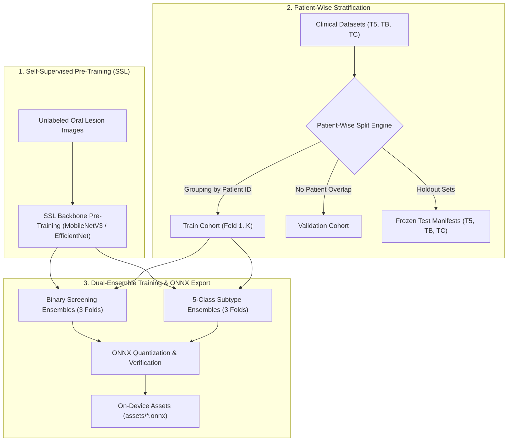

# Model Development and Usage Documentation

**Version:** 1.0  
**Last Updated:** 10 February 2026  
**Target Audience:** Collaborators - AI/ML Engineers

This document serves as the definitive reference for understanding how the oral cavity classification models used in the mobile app were developed, their current performance characteristics, and how they are integrated into the application.

---

## Architecture & Training Pipeline Diagram



---

## Table of Contents

1. [Dataset Distribution](#dataset-distribution)
2. [5-Class Ensemble Development](#5-class-ensemble-development)
3. [Binary Ensemble Development](#binary-ensemble-development)
4. [Mobile App Integration](#mobile-app-integration)
5. [Model Performance](#model-performance)
6. [Known Challenges and Limitations](#known-challenges-and-limitations)
7. [Which notebook does what](#which-notebook-does-what)
8. [Canonical Model Paths (latest)](#canonical-model-paths-latest)
9. [Production model archive (GDrive)](#production-model-archive-gdrive)

---

## Dataset Distribution

The models are trained on three distinct datasets that are merged and mapped appropriately for different training objectives.

### Dataset Sources

#### Canonical source URLs (reference)

| Dataset ID     | Local path (under `$ORAL_DATA_ROOT`, default `~/dev`)                        | Task/labels                                                                | Canonical source URL                                                                                                                                                     | Notes                                                                                          |
| -------------- | ---------------------------------------------------------------------------- | -------------------------------------------------------------------------- | ------------------------------------------------------------------------------------------------------------------------------------------------------------------------ | ---------------------------------------------------------------------------------------------- |
| **T5**         | `~/dev/oral_cavity_5class_dataset`                                           | **5-class** (Healthy, Benign, OPMD, OCA, Unknown/Other as used in project) | [https://zenodo.org/records/10664056](https://zenodo.org/records/10664056)                                                                                               | Primary 5-class reference dataset used in experiments; referred to as "T5" in older notebooks. |
| **TB**         | `~/dev/oral_cavity_binary_dataset`                                           | **Binary** (Cancer vs Non-cancer)                                          | [https://www.kaggle.com/datasets/muhammadatef/oral-cancer-images-for-classification](https://www.kaggle.com/datasets/muhammadatef/oral-cancer-images-for-classification) | External binary dataset; referred to as "TB" in older notebooks.                               |
| **TC**         | `~/dev/oral-images-dataset/Oral-Image-small-binary-dataset`                  | **Binary** (Cancer vs Non-cancer)                                          | [https://data.mendeley.com/datasets/mhjyrn35p4/2](https://data.mendeley.com/datasets/mhjyrn35p4/2)                                                                       | Smaller binary dataset; referred to as "TC" in older notebooks.                                |
| **NEW_MINI_1** | `~/dev/oral-images-dataset/OralCancer-Lip-Tounge`                            | **Small dataset** (verify exact label scheme from folder structure)        | [https://www.kaggle.com/datasets/shivam17299/oral-cancer-lips-and-tongue-images](https://www.kaggle.com/datasets/shivam17299/oral-cancer-lips-and-tongue-images)         | Very small dataset; best for smoke tests / quick sanity checks, not for final claims.          |

#### 1. **oral_cavity_5class_dataset** (~2,838 images)
- **Structure:** Organized into 5 classes: `Benign`, `Healthy`, `OCA` (Oral Cancer), `OPMD` (Oral Potentially Malignant Disorders), `Unknown`
- **Splits:** `train/`, `val/`, `test/`
- **Usage:** 
  - Primary dataset for 5-class ensemble training
  - Mapped to binary labels for binary ensemble training:
    - `OCA` + `OPMD` → `cancer` (label: 1)
    - `Benign` + `Healthy` → `non-cancer` (label: 0)
    - `Unknown` → excluded from binary evaluation
- **Test Set:** T5 (534 samples from `test/` folder, 484 binary-eligible after excluding Unknown)

#### 2. **oral_cavity_binary_dataset** (~1,634 images)
- **Structure:** Binary classification with `cancer/` and `non-cancer/` folders
- **Usage:** Used for binary ensemble training
- **Test Set:** TB (246 samples, 15% holdout, never used in training)
- **Training Pool:** 1,388 images (85% of dataset)

#### 3. **Oral-Image-small-binary-dataset** (~326 images, original only)
- **Structure:** 
  - `original_data/benign_lesions/` → non-cancer (label: 0)
  - `original_data/malignant_lesions/` → cancer (label: 1)
- **Important Note:** Only `original_data/` is used (not `augmented_data/`) to avoid double-augmentation when Albumentations is applied during training
- **Test Set:** TC (49 samples, 15% holdout)
- **Training Pool:** 274 images (85% of dataset)

### Merged Training Pool for Binary Ensemble

When training the binary ensemble, all three datasets are merged:

```
Total Training Images: ~4,500
├── Cancer (label: 1): 2,320 images (51.6%)
│   ├── From 5-class: OCA + OPMD classes
│   ├── From binary dataset: cancer/ folder
│   └── From small binary: malignant_lesions/
└── Non-cancer (label: 0): 2,180 images (48.4%)
    ├── From 5-class: Benign + Healthy classes
    ├── From binary dataset: non-cancer/ folder
    └── From small binary: benign_lesions/
```

**Frozen Test Sets:**
- **T5:** 534 samples (5-class test, 484 binary-eligible)
- **TB:** 246 samples (binary dataset holdout)
- **TC:** 49 samples (small binary dataset holdout)
- **TM:** 779 samples (merged: T5 + TB + TC, used for comprehensive evaluation)

### Frozen Test Sets: Creation and Training Exclusion

Frozen test sets ensure reproducible, comparable evaluation across all models by fixing which images are used for testing. This section explains how they are created and how training guarantees these images are never seen during model training.

#### How Frozen Test Sets Are Created

**T5 (5-Class Test Set):**
- **Source:** Directly from the `test/` folder of `oral_cavity_5class_dataset`
- **Creation:** All images from `test/Benign/`, `test/Healthy/`, `test/OCA/`, `test/OPMD/`, `test/Unknown/` are included
- **Deterministic:** Yes — always the same images since they come from a fixed folder structure
- **Manifest:** Saved to `ml/training/notebooks/frozen_test_sets/T5.json`

**TB (Binary Dataset Test Set):**
- **Source:** `oral_cavity_binary_dataset` (entire dataset, not just val subset)
- **Creation:** Uses `sklearn.model_selection.train_test_split()` with:
  - **Fixed seed:** `SEED = 42` (ensures reproducibility)
  - **Test fraction:** 15% (`BINARY_TEST_FRACTION = 0.15`)
  - **Stratification:** Maintains class balance (cancer vs non-cancer)
- **Deterministic:** Yes — with the same seed and dataset, the split is always identical
- **Manifest:** Saved to `ml/training/notebooks/frozen_test_sets/TB.json`
- **Training Pool:** The remaining 85% (1,388 images) saved to `binary_train_val_for_training.json`

**TC (Small Binary Dataset Test Set):**
- **Source:** `Oral-Image-small-binary-dataset` (only `original_data/`, not `augmented_data/`)
- **Creation:** Same process as TB:
  - Fixed seed: `42`
  - Test fraction: 15%
  - Stratified split
- **Deterministic:** Yes — reproducible with fixed seed
- **Manifest:** Saved to `ml/training/notebooks/frozen_test_sets/TC.json`
- **Training Pool:** The remaining 85% (274 images) saved to `small_binary_train_val_for_training.json`

**TM (Mixed Merged Test Set):**
- **Source:** Union of T5 (binary-eligible, excluding Unknown) + TB + TC
- **Purpose:** Comprehensive evaluation across all data sources
- **Manifest:** Saved to `ml/training/notebooks/frozen_test_sets/TM.json`

#### How Training Ensures Exclusion

The frozen test set mechanism guarantees that images in TB/TC are **never** used during training through a two-step process:

1. **Split and Save Manifests:**
   - When `build_and_save_frozen_sets_v2()` runs, it splits each binary dataset into:
     - **Test set** (15%) → saved to `TB.json` or `TC.json`
     - **Training pool** (85%) → saved to `binary_train_val_for_training.json` or `small_binary_train_val_for_training.json`
   - These are **separate JSON files** with **non-overlapping** image paths

2. **Training Uses Only Training Manifests:**
   - All training notebooks use `get_binary_train_val_for_training()` or `get_all_train_val_for_training()` to load training data
   - These functions **only** load from the training manifests (`*_train_val_for_training.json`)
   - They **never** load from `TB.json` or `TC.json`
   - This ensures complete separation: training code cannot accidentally include frozen test images

**Example Flow:**
```
oral_cavity_binary_dataset/
├── cancer/
└── non-cancer/
         │
         │ train_test_split(seed=42, test_size=0.15)
         │
    ┌────┴────┐
    │         │
    ▼         ▼
TB.json   binary_train_val_for_training.json
(15%)     (85%)
         │
         │ Used by training notebooks
         │ via get_binary_train_val_for_training()
         │
         ▼
    Training Data
    (guaranteed to exclude TB images)
```

#### Reproducibility Guarantees

The deterministic nature of frozen test sets comes from **two layers of guarantees**:

1. **Fixed Seed During Initial Creation:**
   - `SEED = 42` ensures the same random split every time the split is performed
   - If you regenerate frozen sets (with same dataset), you'll get identical results

2. **Saved JSON Manifests (Primary Source of Truth):**
   - Once created, JSON manifests (`TB.json`, `TC.json`, `binary_train_val_for_training.json`, etc.) are saved and reused
   - **All functions read directly from these JSON files** — they don't regenerate the split
   - Functions like `load_frozen_sets_v2()` and `get_binary_train_val_for_training()` simply read from JSON
   - **This is the actual mechanism that ensures determinism:** Fixed paths in JSON files = always same images

**How It Works in Practice:**
- **For Training:** `get_binary_train_val_for_training()` reads `binary_train_val_for_training.json` → always returns the same 1,388 images (excludes TB)
- **For Testing:** `load_frozen_sets_v2()` reads `TB.json`, `TC.json`, `T5.json` → always returns the same test images
- **Result:** Same images used for training/testing across all runs, ensuring fair model comparison

**Key Point:** The deterministic nature comes from the **fixed paths stored in JSON files**, not from re-running the split. The fixed seed is only relevant during initial creation or regeneration.

#### Important Notes

- **T5 is NOT from val subset:** T5 comes from the `test/` folder, not `val/`
- **TB/TC are NOT from val subset:** They come from random splits of the entire binary datasets (not just val)
- **Images remain in place:** JSON manifests contain paths to original locations — images are not copied or moved
- **Regeneration:** If you regenerate frozen sets (by running `build_and_save_frozen_sets_v2()`), you'll get the same split due to the fixed seed, but only if the dataset hasn't changed

#### Implementation Details

- **Script:** `ml/training/notebooks/frozen_test_sets.py`
- **Manifest Location:** `ml/training/notebooks/frozen_test_sets/`
- **Key Functions:**
  - `build_and_save_frozen_sets_v2()` — Creates all frozen sets and training manifests
  - `load_frozen_sets_v2()` — Loads frozen sets for evaluation
  - `get_binary_train_val_for_training()` — Returns training data (excludes TB)
  - `get_all_train_val_for_training()` — Returns all training data (excludes TB and TC)

### Dataset Challenges

1. **Class Imbalance:** 5-class dataset has uneven distribution across classes
2. **Small Dataset Size:** Particularly for the small binary dataset (326 images)
3. **Domain Shift:** Three different sources may have different imaging conditions, equipment, or annotation protocols
4. **Unknown Class:** The "Unknown" class in 5-class dataset represents ambiguous cases that cannot be reliably classified

---

## 5-Class Ensemble Development

### Training Pipeline

The 5-class ensemble models are developed using the following notebooks:

1. **`production_oral_cavity_classifier.ipynb`** - Main training notebook
2. **`pytorch_to_onnx_ensemble.ipynb`** - ONNX conversion and ensemble implementation

### Architecture

- **Backbone:** MobileNetV3Large (ImageNet pre-trained)
- **Output:** 5 classes (`Benign`, `Healthy`, `OCA`, `OPMD`, `Unknown`)
- **Ensemble Size:** 3 models
- **Ensemble Weights:** [0.30, 0.40, 0.30] for models 1, 2, and 3 respectively

### Model Variants

The three ensemble models differ in:
- **Dropout rates:** [0.3, 0.1, 0.2] for models 1, 2, and 3
- **Architecture variations:** Model 3 has a slightly different classifier head (512-dim intermediate layer vs 256-dim)

### Training Configuration

- **Image Size:** 224×224
- **Batch Size:** 32
- **Learning Rate:** 1e-4
- **Optimizer:** Adam
- **Scheduler:** Cosine annealing
- **Epochs:** 50 (with early stopping, patience=10)
- **Augmentation:** Medical-grade Albumentations (when available) or torchvision transforms
- **Class Weights:** Applied to prioritize critical classes:
  - `OCA`: 1.5× weight (most critical)
  - `OPMD`: 1.2× weight (high importance)
  - `Benign`, `Healthy`: 1.0× weight (standard)
  - `Unknown`: 0.8× weight (lower priority)

### ONNX Conversion

- **Format:** Single-file ONNX (no external data files)
- **Opset Version:** 18
- **Input:** `[batch_size, 3, 224, 224]` (dynamic batch size)
- **Output:** `[batch_size, 5]` logits
- **Preprocessing:** ImageNet normalization (mean=[0.485, 0.456, 0.406], std=[0.229, 0.224, 0.225])

### Ensemble Inference

At inference time:
1. Each model produces 5-class logits
2. Logits are weighted by ensemble weights
3. Weighted logits are averaged
4. Softmax is applied to get probabilities
5. Class weights are applied to probabilities (OCA/OPMD get higher weight)
6. Final prediction is the class with highest weighted probability

### Performance

- **Accuracy:** 76.36% (reported in app)
- **Model Size:** 36.9 MB total (3 × ~12.3 MB per model)

---

## Binary Ensemble Development

### Training Pipeline

**Current Production Models:**
The binary ensemble models currently deployed in the mobile app (`binary_ensemble_mode_1.onnx`, `binary_ensemble_mode_2.onnx`, `binary_ensemble_mode_3.onnx`) were trained using:

- **`improved_binary_training.ipynb`** - This notebook created the production binary ensemble using a **full fine-tune** strategy (all parameters trainable from epoch 1)

**Ongoing Exploration:**
- **`freeze_strategy_comparison.ipynb`** - Systematic comparison of freeze strategies (results available, see [Freeze Strategy Comparison Results](#freeze-strategy-comparison-results))
  - **Status:** All training complete. Full fine-tune achieves highest performance (mean AUC 0.8996, best individual 0.9048).
  - **Finding:** Full fine-tune outperforms progressive K=5 (mean AUC 0.8912) by 0.0084 AUC, achieving best ensemble mean and highest individual AUC.
  - **Next Step:** Evaluate all strategies on frozen test sets (T5, TB, TC, TM) for final comparison including per-source breakdown and calibration metrics.
  - **Future Consideration:** Exploring the value of using unlabeled oral images for self-supervised pre-training of the backbone before fine-tuning on labeled datasets (binary and 5-class)

### Architecture

- **Backbone:** MobileNetV3Large (same as 5-class for consistency)
- **Output:** 2 classes (`non-cancer`, `cancer`)
- **Ensemble Size:** 3 models
- **Ensemble Weights:** [0.30, 0.40, 0.30] for models 1, 2, and 3 respectively

### Training Strategy (Current Production)

The current production models use **full fine-tune** strategy (all parameters trainable from epoch 1), as implemented in `improved_binary_training.ipynb`.

**Strategies Being Explored in `freeze_strategy_comparison.ipynb`:**
1. **Head-only:** Freeze entire backbone, train classifier only (diagnostic baseline)
2. **Progressive K=3:** Head warm-up (5 epochs) → unfreeze last 3 backbone blocks
3. **Progressive K=5:** Head warm-up (5 epochs) → unfreeze last 5 backbone blocks
4. **Full fine-tune:** All parameters trainable (baseline for comparison)

*Note: Results from the freeze strategy comparison will inform future model updates. This document will be updated once the comparison is complete.*

### Freeze Strategy Comparison Results

**Notebook:** `freeze_strategy_comparison.ipynb`  
**Run:** `freeze_comparison_20260208_121618`  
**Status:** All training complete. Ready for evaluation on frozen test sets.

#### Validation Performance Summary

| Strategy | Ensemble Mean Val AUC | Best Individual Val AUC | Best Val Acc | Trainable Params (per model) |
|----------|----------------------|------------------------|--------------|------------------------------|
| **head_only** | 0.8723 | 0.8745 (ensemble_2) | 78.07% | 246,530 / 3,218,482 |
| **progressive_K3** | 0.8737 | 0.8749 (ensemble_3) | 79.41% | 1,996,770 (after unfreeze) |
| **progressive_K5** | 0.8912 | 0.9007 (ensemble_3) | 81.78% | 2,812,114 (after unfreeze) |
| **full_finetune** | 0.8996 | 0.9048 (ensemble_3) | 81.93% | 3,218,482 / 3,218,482 |

**Key Finding (validation):** Full fine-tune had highest validation AUC (0.8996 mean). **On frozen test sets (T5/TB/TC/TM), progressive_K5 is the winning strategy** (best TM AUC 0.9291, best source stability, best min(T5,TB) AUC with TM sensitivity ≥ 80%); see [Final comparison on frozen test sets](#final-comparison-on-frozen-test-sets) below.

#### Detailed Training Logs

**Strategy: head_only** (Frozen backbone, train head only - diagnostic baseline)

- **Ensemble 1:** Best val_acc=75.56%, val_auc=0.8715 (early stop epoch 40)
- **Ensemble 2:** Best val_acc=78.07%, val_auc=0.8745 (early stop epoch 46)
- **Ensemble 3:** Best val_acc=77.78%, val_auc=0.8709 (early stop epoch 44)
- **Ensemble Mean Val AUC:** 0.8723

**Strategy: progressive_K3** (Head warm-up 5 ep → unfreeze last 3 blocks)

- **Ensemble 1:** Best val_acc=77.93%, val_auc=0.8713 (early stop epoch 23)
- **Ensemble 2:** Best val_acc=76.74%, val_auc=0.8748 (early stop epoch 21)
- **Ensemble 3:** Best val_acc=79.41%, val_auc=0.8749 (early stop epoch 42)
- **Ensemble Mean Val AUC:** 0.8737

**Strategy: progressive_K5** (Head warm-up 5 ep → unfreeze last 5 blocks)

- **Ensemble 1:** Best val_acc=77.93%, val_auc=0.8847 (early stop epoch 24)
- **Ensemble 2:** Best val_acc=81.93%, val_auc=0.8881 (early stop epoch 33)
- **Ensemble 3:** Best val_acc=81.78%, val_auc=0.9007 (early stop epoch 42)
- **Ensemble Mean Val AUC:** 0.8912 ⭐ **Best performing strategy**

**Strategy: full_finetune** (All parameters trainable from epoch 1 - current production baseline)

- **Ensemble 1:** Best val_acc=81.04%, val_auc=0.8896 (early stop epoch 23)
- **Ensemble 2:** Best val_acc=81.93%, val_auc=0.9044 (early stop epoch 33)
- **Ensemble 3:** Best val_acc=81.33%, val_auc=0.9048 (early stop epoch 27)
- **Ensemble Mean Val AUC:** 0.8996 ⭐ **Highest individual AUC (0.9048)**

**Complete Training Logs for full_finetune ensemble_3:**

```
[3/3] ensemble_3
[ensemble_3] full_finetune: 3,465,010 / 3,465,010 trainable
  Ep   1/50  loss=0.4594  train=77.73%  val=77.48%  auc=0.8785  lr=9.99e-05
  Ep   5/50  loss=0.2509  train=92.76%  val=77.78%  auc=0.8790  lr=9.76e-05
  Ep  10/50  loss=0.1802  train=96.71%  val=81.63%  auc=0.8909  lr=9.05e-05
  Ep  15/50  loss=0.1657  train=97.31%  val=81.04%  auc=0.8912  lr=7.96e-05
  Ep  20/50  loss=0.1524  train=97.83%  val=82.07%  auc=0.8960  lr=6.58e-05
  Ep  25/50  loss=0.1459  train=98.17%  val=79.85%  auc=0.9036  lr=5.05e-05
  Ep  30/50  loss=0.1452  train=98.09%  val=82.52%  auc=0.9010  lr=3.52e-05
  Ep  35/50  loss=0.1454  train=98.17%  val=80.44%  auc=0.9031  lr=2.14e-05
  Ep  38/50  loss=0.1410  train=98.35%  val=82.37%  auc=0.9031  lr=1.44e-05
  Early stop at epoch 27
  Best: val_acc=81.33%, val_auc=0.9048
```

*Note: Training logs extracted from TensorBoard event files. Best model checkpoint saved at epoch 27 (0-indexed: epoch 26) with validation AUC 0.9048.*

#### Preliminary Observations

1. **Progressive K=5 outperforms head-only:** Mean AUC improvement of 0.0189 (0.8912 vs 0.8723) suggests backbone adaptation provides value beyond ImageNet features alone.

2. **Progressive K=5 competitive with full fine-tune:** Best individual AUCs are similar (0.9007 vs 0.9044), suggesting progressive unfreezing may provide better generalization with less overfitting risk.

3. **Head-only baseline is strong:** AUC 0.8723 indicates ImageNet features + trained head alone achieve reasonable performance, confirming the pretrained backbone provides useful features.

4. **Early stopping patterns:** Progressive strategies tend to stop earlier (epochs 21-42) compared to head-only (epochs 40-46), possibly indicating faster convergence or earlier overfitting.

#### Final comparison on frozen test sets

| Strategy         | T5 AUC | TB AUC | TC AUC | TM AUC | TM Sens | TM Spec | S@90Sp | Brier  | ECE    | Params   |
| ---------------- | ------ | ------ | ------ | ------ | ------- | ------- | ------ | ------ | ------ | -------- |
| head_only        | 0.8259 | 0.9718 | 0.9900 | 0.8952 | 87.06%  | 73.47%  | 70.1%  | 0.1353 | 0.0561 | 246,530  |
| progressive_K3   | 0.8559 | 0.9843 | 1.0000 | 0.9149 | 87.31%  | 73.74%  | 73.6%  | 0.1263 | 0.0599 | 1,996,770 |
| progressive_K5   | 0.8830 | 0.9836 | 0.9983 | **0.9291** | 85.57%  | 83.55%  | **78.9%** | **0.1099** | **0.0476** | 2,812,114 |
| full_finetune    | 0.8810 | 0.9774 | 1.0000 | 0.9235 | 85.57%  | 85.94%  | 82.6%  | **0.1094** | 0.0578 | 3,218,482 |

**Recommendation (binary ensemble):** **Winner: progressive_K5.** Criterion: highest min(T5_AUC, TB_AUC) with TM sensitivity ≥ 80%. Score: min(T5, TB) AUC = 0.8830. Source stability (T5 vs TB gap) is best for progressive_K5 (gap 0.1006). Bootstrap CI (TM AUROC): progressive_K5 0.9291 [0.9118, 0.9455].

**Next steps (planned):**

1. **5-class progressive_K5 first** – Create a 5-class ensemble using the same progressive_K5 strategy (head warm-up 5 epochs → unfreeze last 5 backbone blocks) as in `freeze_strategy_comparison.ipynb`, using the same backbone (MobileNetV3Large) and 5-class head. Train on the 5-class dataset (e.g. `production_oral_cavity_classifier.ipynb` data setup) and compare to the **current 5-class production ensemble** (full fine-tune) on T5 and, if desired, binary view on T5/TB/TM.
2. **Agreement analysis** – After 5-class progressive_K5 is available, run agreement analysis for the **binary progressive_K5 ensemble** (e.g. vs current 5-class ensemble or vs the new 5-class progressive_K5 ensemble) on frozen sets (e.g. TM) to see how often the two ensembles agree on referral vs label, and to document disagreement patterns.

---

### Training Configuration

- **Image Size:** 224×224
- **Batch Size:** 32
- **Learning Rate:** 1e-4 (full fine-tune) or discriminative LR for progressive strategies
- **Optimizer:** Adam
- **Scheduler:** Cosine annealing
- **Epochs:** 50 (main training) + 5 warmup epochs for progressive strategies
- **Patience:** 12 epochs
- **Augmentation:** Medical-grade Albumentations pipeline:
  - Geometric: RandomRotate90, Flip, ShiftScaleRotate
  - Color/contrast: RandomBrightnessContrast, HueSaturationValue, CLAHE
  - Noise: GaussNoise, ISONoise
  - Quality degradation: MotionBlur, GaussianBlur, ImageCompression
- **Class Weights:** 
  - Balanced class weights computed from training data
  - Cancer weight multiplier: 1.5× (increased sensitivity for cancer detection)
- **Label Smoothing:** 0.05

### Data Merging Strategy

The binary ensemble is trained on merged data from all three sources:

1. **5-class dataset** → mapped to binary (OCA+OPMD→cancer, Benign+Healthy→non-cancer)
2. **Binary dataset** → direct binary labels
3. **Small binary dataset** → direct binary labels (original images only)

**Deduplication:** Path-based deduplication ensures no image appears multiple times in training set.

**Final Training Pool:**
- Train: 3,825 images (1,972 cancer, 1,853 non-cancer)
- Val: 675 images (348 cancer, 327 non-cancer)
- Test: TM (779 samples across all sources)

### ONNX Conversion

- **Format:** Single-file ONNX (no external data files)
- **Opset Version:** 18
- **Input:** `[batch_size, 3, 224, 224]` (dynamic batch size)
- **Output:** `[batch_size, 2]` logits (index 0 = non-cancer, index 1 = cancer)
- **Preprocessing:** Same ImageNet normalization as 5-class models

### Ensemble Inference

At inference time:
1. Each model produces 2-class logits
2. Logits are weighted by ensemble weights
3. Weighted logits are averaged
4. Softmax is applied to get probabilities
5. Cancer probability = `P(cancer)` = softmax(logits)[1]
6. Referral decision: `isCancer = (cancer_probability >= threshold)`
   - Low referral threshold: 0.31 (≈86% sensitivity @ 80% specificity)
   - High referral threshold: 0.54 (≈83% sensitivity @ 85% specificity)

### Performance

**On Frozen Test Sets (TM - Merged):**
- **Accuracy:** 84.47%
- **Sensitivity:** 85.07%
- **Specificity:** 83.82%
- **AUROC:** 0.9277
- **AUPRC:** 0.9403

**Per-Source Breakdown:**
- **T5 (5-class source):** Acc=79.55%, Sens=80.82%, Spec=78.24%, AUROC=0.8863
- **TB (binary source):** Acc=93.09%, Sens=90.23%, Spec=96.46%, AUROC=0.9800
- **TC (small binary source):** Acc=89.80%, Sens=100.00%, Spec=80.00%, AUROC=1.0000

**Agreement with 5-class Ensemble:** 80.7% agreement on TM (629/779 samples) — *production binary (full fine-tune) vs production 5-class (full fine-tune).*

#### Agreement analysis: binary progressive_K5 vs 5-class progressive_K5 (TM)

After training the 5-class ensemble with the same progressive_K5 strategy, agreement was re-run on TM using **ONNX models only** (no PyTorch architecture; see `improved_5class_ensemble.ipynb` §9 and `model_registry.py`).

| Metric | Value |
|--------|--------|
| **Overall agreement** | **80.44%** (625/777 samples; 2 skipped where 5-class predicted Unknown) |
| **Confusion (rows=5-class→binary, cols=binary)** | non-cancer: 310 agree / 91 binary says cancer; cancer: 61 binary says non-cancer / 315 agree |

**Interpretation**

- **Overall:** Agreement is effectively the same as production (~80.4% vs 80.7%). Using the same training strategy (progressive_K5) for both binary and 5-class did not increase or decrease agreement.
- **Confusion matrix:** When the 5-class model maps to “non-cancer” (Benign/Healthy), the binary model still says “cancer” in 91 cases (referral when 5-class is benign). When 5-class maps to “cancer” (OCA/OPMD), the binary model says “non-cancer” in 61 cases (no referral when 5-class is suspicious). The app’s disagreement logic is designed for these patterns.
- **Per-source:** Agreement is highest on Source A (84.9%, 5-class-origin) and Source C (85.7%, small binary), and lowest on Source B (70.5%, main binary dataset). That suggests the binary ensemble behaves differently on B (its training included B); the 5-class model was trained only on 5-class (A-like) data, so on B the two pipelines can diverge more.

**Comparison to before**

| Comparison | Agreement | Notes |
|------------|-----------|--------|
| **Production binary vs production 5-class** | 80.7% (629/779) | Full fine-tune for both; previous baseline. |
| **Binary progressive_K5 vs 5-class progressive_K5** | 80.44% (625/777) | Same strategy for both; ONNX-based run. |

Conclusion: Switching both sides to progressive_K5 keeps agreement at roughly the same level as production; the main benefit of progressive_K5 is better frozen-set performance (e.g. TM AUC), not higher binary–5-class agreement.

### Model Assets

- **File Names:** `binary_ensemble_mode_1.onnx`, `binary_ensemble_mode_2.onnx`, `binary_ensemble_mode_3.onnx`
- **Location:** `assets/` directory
- **Total Size:** ~36.9 MB (3 × ~12.3 MB per model)

---

## Mobile App Integration

### Model Inference Service

The mobile app uses `lib/services/model_inference_service.dart` to orchestrate model inference. This service implements:

1. **Model Loading:** Loads both 5-class and binary ensemble models from assets
2. **Dual Ensemble:** Combines binary (referral decision) + 5-class (detailed label) predictions
3. **Decision Matrix:** Applies risk elevation logic based on both ensemble outputs
4. **Multi-Photo Aggregation:** Aggregates predictions across multiple photos in a screening session

### Model Assets in App

**5-Class Ensemble:**
- `assets/ensemble_model_1.onnx`
- `assets/ensemble_model_2.onnx`
- `assets/ensemble_model_3.onnx`

**Binary Ensemble:**
- `assets/binary_ensemble_mode_1.onnx`
- `assets/binary_ensemble_mode_2.onnx`
- `assets/binary_ensemble_mode_3.onnx`

### Inference Flow

#### Single Photo Inference

1. **Preprocessing:**
   - Resize to 224×224
   - Apply ImageNet normalization
   - Convert to NCHW format (batch, channels, height, width)

2. **5-Class Ensemble:**
   - Run inference on all 3 models
   - Weighted average of logits
   - Apply softmax → probabilities
   - Apply class weights (OCA/OPMD get higher weight)
   - Final label = class with highest weighted probability

3. **Binary Ensemble (if dual-ensemble enabled):**
   - Run inference on all 3 models
   - Weighted average of logits
   - Apply softmax → cancer probability
   - Referral decision: `isCancer = (cancer_probability >= 0.31)`

4. **Dual Ensemble Decision Matrix:**
   - **Step 1:** Risk from binary ensemble:
     - Low: `cancer_prob < 0.31`
     - Moderate: `0.31 <= cancer_prob < 0.54`
     - High: `cancer_prob >= 0.54`
   - **Step 2:** Elevate risk based on 5-class probabilities:
     - If `pOCA >= 0.55` → High Risk
     - If `pOCA >= 0.40` + binary moderate → High Risk
     - If `pOPMD >= 0.45` + binary low → Moderate Risk
   - **Step 3:** Display label from 5-class ensemble
   - **Step 4:** Generate disagreement note if ensembles disagree

#### Multi-Photo Screening

1. **Per-Photo Analysis:**
   - Each photo analyzed independently using dual ensemble
   - Quality score computed
   - Non-oral photos filtered (high UNKNOWN probability)

2. **Photo Filtering:**
   - Skip photos with `UNKNOWN` probability > 0.6 (non-oral images)
   - Require minimum quality score ≥ 0.5

3. **Top-K Selection:**
   - Select top 3 photos by reliability weight
   - Reliability weight = `quality_score × (0.6 × binary_confidence + 0.4 × 5class_confidence)`

4. **Aggregation:**
   - Weighted average of probabilities from selected photos
   - Overall risk = maximum risk level across all photos
   - Overall confidence = max confidence from aggregated probabilities

### Decision Matrix Thresholds

**Binary Referral Thresholds:**
- Low referral: 0.31 (86% sensitivity @ 80% specificity)
- High referral: 0.54 (83% sensitivity @ 85% specificity)

**5-Class Elevation Thresholds:**
- OCA high threshold: 0.55
- OCA low threshold: 0.40
- OPMD threshold: 0.45
- Label confidence threshold: 0.50

**Quality Thresholds:**
- Minimum quality score: 0.5
- UNKNOWN threshold (non-oral detection): 0.6

### Risk Levels

- **Low Risk:** Binary low + no 5-class elevation
- **Moderate Risk:** Binary moderate OR (binary low + OPMD elevation)
- **High Risk:** Binary high OR (binary moderate + OCA elevation) OR (OCA >= 0.55)

### Disagreement Types

The app detects and reports disagreements between binary and 5-class ensembles:

- **Type A:** Binary referral, 5-class benign/healthy → "Review recommended"
- **Type B:** Binary low, 5-class suspicious → "Treat cautiously, consider follow-up"
- **Type C:** Low confidence across models → "Consider retaking photos"

---

## Model Performance

### 5-Class Ensemble

**Reported Performance:**
- Accuracy: 76.36%
- Model Size: 36.9 MB (3 models)

**Test Set:** T5 (534 samples from 5-class test set)

### Binary Ensemble

**Reported Performance:**
- Accuracy: 84.47% (TM merged test)
- Sensitivity: 85.07%
- Specificity: 83.82%
- AUROC: 0.9277
- AUPRC: 0.9403
- Model Size: 36.9 MB (3 models)

**Dual Ensemble (Binary + 5-Class):**
- Reported Accuracy: 84.11%
- Combines referral decision (binary) with detailed classification (5-class)

### Performance by Test Set

**Binary Ensemble:**

| Test Set | N    | Accuracy | Sensitivity | Specificity | AUROC  | AUPRC  |
|----------|------|----------|------------|-------------|--------|--------|
| T5       | 484  | 79.55%   | 80.82%     | 78.24%      | 0.8863 | 0.8998 |
| TB       | 246  | 93.09%   | 90.23%     | 96.46%      | 0.9800 | 0.9863 |
| TC       | 49   | 89.80%   | 100.00%    | 80.00%      | 1.0000 | 1.0000 |
| TM       | 779  | 84.47%   | 85.07%     | 83.82%      | 0.9277 | 0.9403 |

**Key Observations:**
- Best performance on TB (binary dataset source) - likely due to domain match
- Good performance on TC (small binary) but small sample size limits reliability
- T5 (5-class source) shows lower performance, indicating some domain shift
- TM (merged) provides balanced view across all sources

---

## Known Challenges and Limitations

### Dataset Challenges

1. **Small Dataset Size:**
   - Total training images: ~4,500 (binary ensemble)
   - Small binary dataset: only 326 images
   - 5-class dataset: ~2,838 images with class imbalance
   - **Impact:** Models may not generalize well to unseen imaging conditions or populations

2. **Class Imbalance:**
   - 5-class dataset has uneven distribution
   - Unknown class represents ambiguous cases
   - **Mitigation:** Class weights applied during training, but imbalance remains a concern

3. **Domain Shift:**
   - Three different data sources (A, B, C) with potentially different:
     - Imaging equipment
     - Lighting conditions
     - Annotation protocols
     - Patient populations
   - **Evidence:** Performance gap between T5 (source A) and TB (source B) in binary ensemble
   - **Impact:** Models may perform differently on images from different sources

4. **Unknown Class Ambiguity:**
   - "Unknown" class in 5-class dataset represents cases that cannot be reliably classified
   - Excluded from binary evaluation
   - **Impact:** Some ambiguous cases may be misclassified

### Model Limitations

1. **Ensemble Agreement:**
   - Binary and 5-class ensembles agree on 80.7% of samples
   - 19.3% disagreement indicates uncertainty in some cases
   - **Impact:** Disagreement notes shown to users, but may cause confusion

2. **Calibration:**
   - Probability outputs may not be perfectly calibrated
   - Brier score and ECE metrics available in evaluation notebooks
   - **Impact:** Confidence scores may not reflect true uncertainty

3. **Mobile Deployment:**
   - Total model size: ~73.8 MB (both ensembles)
   - Inference time depends on device capabilities
   - **Impact:** May be slow on low-end devices

4. **Generalization:**
   - Models trained on specific datasets may not generalize to:
     - Different imaging conditions
     - Different populations
     - Different camera types/qualities
   - **Impact:** Performance may degrade in real-world deployment

### Technical Debt

1. **Freeze Strategy Comparison (In Progress):**
   - Current production models (`binary_ensemble_mode_*.onnx`) use full fine-tune from `improved_binary_training.ipynb`
   - `freeze_strategy_comparison.ipynb` compared head-only, progressive_K3, progressive_K5, and full fine-tune on frozen test sets. **Winner: progressive_K5** (best TM AUC, best source stability, best min(T5,TB) AUC with TM sensitivity ≥ 80%). See [Freeze Strategy Comparison Results](#freeze-strategy-comparison-results) for the final comparison table.
   - **Planned:** Apply progressive_K5 to the **5-class** ensemble (train 5-class with same unfreezing strategy, then compare to current 5-class production model). Follow with agreement analysis between binary progressive_K5 and 5-class (current or new progressive_K5) on frozen sets.

2. **Augmentation:**
   - Medical-grade Albumentations pipeline defined but may not always be available
   - Falls back to basic torchvision transforms
   - **Impact:** Training may be inconsistent across runs

3. **Evaluation:**
   - Frozen test sets ensure reproducibility
   - But evaluation metrics may not fully capture clinical utility
   - **Opportunity:** Clinical validation needed

### Recommendations for Improvement

1. **Data Collection:**
   - Collect more diverse images from different sources
   - Standardize imaging protocols
   - Increase dataset size, especially for underrepresented classes

2. **Model Architecture:**
   - **Completed:** Freeze strategy comparison (`freeze_strategy_comparison.ipynb`) – **progressive_K5** is the winning binary strategy on frozen sets (TM AUC 0.9291, best source stability). See [Freeze Strategy Comparison Results](#freeze-strategy-comparison-results) for the final comparison table.
   - **Planned:** Train a **5-class ensemble** with the same progressive_K5 strategy and compare to current 5-class production model; then run agreement analysis (binary progressive_K5 vs 5-class).
   - **Future Exploration:** Self-supervised pre-training with unlabeled oral images before fine-tuning on labeled datasets
   - Explore larger architectures if mobile constraints allow

3. **Evaluation:**
   - Conduct clinical validation studies
   - Collect real-world performance metrics
   - Monitor model performance over time

4. **Calibration:**
   - Implement probability calibration techniques
   - Provide uncertainty estimates to users
   - Consider conformal prediction for reliable confidence intervals

---

## Which notebook does what

| Notebook | Purpose | Output / Use |
| -------- | ------- | ------------- |
| **production_oral_cavity_classifier.ipynb** | Trains the **current production 5-class** ensemble (full fine-tune, all parameters trainable). Uses 5-class dataset (original or merged with synthetic). | Baseline 5-class models; compare against improved_5class_ensemble. |
| **pytorch_to_onnx_ensemble.ipynb** | Converts trained 5-class PyTorch ensemble to ONNX and evaluates. Loads `.pth` checkpoints (e.g. from production or improved_5class notebook), exports to `ensemble_model_1/2/3.onnx`. | ONNX assets for app (`assets/ensemble_model_*.onnx`). |
| **improved_binary_training.ipynb** | Trains the **current production binary** ensemble (full fine-tune) on merged binary data (5-class + TB + TC train/val). | Production binary models (`binary_ensemble_mode_*.onnx`). |
| **freeze_strategy_comparison.ipynb** | Compares **binary** freeze strategies: head_only, progressive_K3, progressive_K5, full_finetune. Uses merged binary data and frozen test sets T5/TB/TC/TM. | **Winner: progressive_K5.** Checkpoints and comparison metrics; informs binary strategy. |
| **improved_5class_ensemble.ipynb** | Trains a **5-class** ensemble using **progressive_K5** (same strategy that won for binary). 5-class dataset only. Includes placeholder for **agreement analysis** (binary progressive_K5 vs 5-class progressive_K5 on T5/TM). | 5-class progressive_K5 checkpoints; comparison vs current 5-class; agreement analysis with binary ensemble. |

**Typical workflow**

- **5-class production:** `production_oral_cavity_classifier.ipynb` → `pytorch_to_onnx_ensemble.ipynb` (load production .pth, export ONNX).
- **Binary production:** `improved_binary_training.ipynb` (then ONNX export as in that notebook or a dedicated conversion cell).
- **Strategy comparison (binary):** `freeze_strategy_comparison.ipynb`.
- **5-class with winning strategy + agreement:** `improved_5class_ensemble.ipynb` (progressive_K5 for 5-class, then agreement analysis with binary progressive_K5).

---

## Canonical Model Paths (latest)

All notebooks that load models for evaluation or agreement analysis should reference these
canonical paths via `model_registry.py` (in `ml/training/notebooks/`).  
**Do not hardcode model paths in notebooks — always import from the registry.**

### Binary Ensemble — progressive_K5 (winner on frozen test sets)

| Item | Value |
|------|-------|
| **Source notebook** | `freeze_strategy_comparison.ipynb` |
| **Run ID** | `freeze_comparison_20260208_121618` |
| **Strategy** | progressive_K5 (head warm-up 5 ep → unfreeze last 5 blocks) |
| **ONNX models** | `ml/training/notebooks/results/freeze_comparison/freeze_comparison_20260208_121618/onnx/ensemble_model_1.onnx` |
|                  | `ml/training/notebooks/results/freeze_comparison/freeze_comparison_20260208_121618/onnx/ensemble_model_2.onnx` |
|                  | `ml/training/notebooks/results/freeze_comparison/freeze_comparison_20260208_121618/onnx/ensemble_model_3.onnx` |
| **PTH checkpoints** | `…/models/progressive_K5_ensemble_1.pth`, `…_2.pth`, `…_3.pth` |
| **TM AUC** | 0.9291 |
| **Exported** | 09 Feb 2026 (section 18 of freeze_strategy_comparison.ipynb) |

### 5-Class Ensemble — progressive_K5

| Item | Value |
|------|-------|
| **Source notebook** | `improved_5class_ensemble.ipynb` |
| **Run ID** | `improved_5class_20260209_172821` |
| **Strategy** | progressive_K5 (same as binary winner, applied to 5-class task) |
| **ONNX models** | `ml/training/notebooks/results/improved_5class/improved_5class_20260209_172821/onnx/ensemble_model_1.onnx` |
|                  | `ml/training/notebooks/results/improved_5class/improved_5class_20260209_172821/onnx/ensemble_model_2.onnx` |
|                  | `ml/training/notebooks/results/improved_5class/improved_5class_20260209_172821/onnx/ensemble_model_3.onnx` |
| **PTH checkpoints** | `…/models/ensemble_1_progressive_K5.pth`, `…_2_…`, `…_3_…` |
| **T5 accuracy** | 75.84% |
| **T5 macro AUC** | 0.9299 |
| **Exported** | 10 Feb 2026 (section 8a of improved_5class_ensemble.ipynb) |

### Current Production Models (deployed in app) 

Date this Doc was updated: 23/05/2026 (models were created before this date)

Both ensembles in `assets/` are **SSL backbone + full fine-tune**, patient-wise trained in a single run. They supersede the earlier ImageNet full-finetune and progressive_K5 candidates.

| Ensemble | Role in app | Source notebook | Run ID | Git commit (ONNX in repo) |
|----------|-------------|-----------------|--------|---------------------------|
| **Binary** (`assets/binary_ensemble_mode_*.onnx`) | Referral decision (V2 binary ensemble) | `ssl_multitask_ensembles_patientwise.ipynb` | `ssl_multitask_ensembles_20260303_120722` | `0e82dfc` (Mar 2026) |
| **5-class** (`assets/ensemble_model_*.onnx`) | Lesion subtype (informational only) | same | same | `1573cf4` (Apr 2026, app v0.1.11+17) |

Training ONNX source directory:

`ml/training/notebooks/results/ssl_multitask_ensembles/ssl_multitask_ensembles_20260303_120722/onnx/`

| App asset | Training source file |
|-----------|---------------------|
| `assets/binary_ensemble_mode_1.onnx` | `binary_ssl_fullft_model_1.onnx` |
| `assets/binary_ensemble_mode_2.onnx` | `binary_ssl_fullft_model_2.onnx` |
| `assets/binary_ensemble_mode_3.onnx` | `binary_ssl_fullft_model_3.onnx` |
| `assets/ensemble_model_1.onnx` | `class5_ssl_fullft_model_1.onnx` |
| `assets/ensemble_model_2.onnx` | `class5_ssl_fullft_model_2.onnx` |
| `assets/ensemble_model_3.onnx` | `class5_ssl_fullft_model_3.onnx` |

> **Filename note:** Binary assets keep the historical `binary_ensemble_mode_*` spelling (typo from early export). 5-class assets use `ensemble_model_*`. Do not rename binary filenames in production — the app loads these exact paths.

### Production asset checksum verification (May 2026)

SHA256 of local `assets/` ONNX files was compared against the SSL training run above. **All six files match exactly** (verified locally and against commit `1573cf4` for 5-class; binary unchanged since `0e82dfc`).

| App asset | SHA256 | Matches training ONNX? |
|-----------|--------|------------------------|
| `binary_ensemble_mode_1.onnx` | `aa2d45908f023d14693b2def3ed57a07a67d68c63d516cfd5e6adbfb2b7cbd6a` | Yes |
| `binary_ensemble_mode_2.onnx` | `43b34bd1a1c01bb6eb7128f2c5a0ac8f4f13a73492cdecaec81028692f29389a` | Yes |
| `binary_ensemble_mode_3.onnx` | `f868212ac31358a67bec439653ac32db54ea7b6cfbaa16b36b8630c15ddce67e` | Yes |
| `ensemble_model_1.onnx` | `01042dab8a5dbcbf94d473aef4f424411e399fdc6f5c6dc2c66299b83e13ef8c` | Yes |
| `ensemble_model_2.onnx` | `9a34d39472ca1d08139baf637571fcaa9cff16df8e7d6616befb8e0dd2527dd9` | Yes |
| `ensemble_model_3.onnx` | `00363ada6c76259a184fba706793b9771346d2838cc7485e6c7cf7e4055ba12d` | Yes |

Re-verify anytime:

```bash
shasum -a 256 assets/binary_ensemble_mode_*.onnx assets/ensemble_model_*.onnx
shasum -a 256 ml/training/notebooks/results/ssl_multitask_ensembles/ssl_multitask_ensembles_20260303_120722/onnx/*.onnx
```

Commit `1573cf40224a10927db89afd66be9e4418560243` replaced the previous 5-class full-finetune ONNX in `assets/ensemble_model_*` (12.3–13.9 MB) with the SSL `class5_ssl_fullft_*` files (12.6 MB each) and removed the unused misnamed `assets/ensemble_mode_*` copies. Binary SSL ONNX was already in git from `0e82dfc`; it was not part of that commit.

### Reported accuracy (patient-wise TM_v3 frozen test set)

Metrics below are from `ssl_multitask_ensembles_patientwise.ipynb` run `ssl_multitask_ensembles_20260303_120722`, documented in `docs/PATIENTWISE_MODEL_DEVELOPMENT.md` §6. Evaluation uses the frozen **TM_v3** master (patient-wise, no leakage). App screening thresholds for binary are in `lib/services/screening_config.dart` (e.g. hybridAvg ≥ 0.4735).

**Binary SSL ensemble** (drives referral):

| Metric @ threshold 0.5 | Value |
|------------------------|-------|
| AUC | **0.9202** |
| Accuracy | 0.8144 |
| Sensitivity | 0.8174 |
| Specificity | 0.8124 |

| Target specificity | Sensitivity | Achieved spec | Threshold |
|--------------------|-------------|---------------|-----------|
| 0.80 | **0.8315** | 0.8011 | 0.4735 |
| 0.90 | **0.7416** | 0.9006 | 0.7128 |

**5-class SSL ensemble** (subtype in app; TM_v3 metrics in **binary view**: OCA ∪ OPMD vs others — same view as prior patient-wise 5-class baselines):

| Metric @ threshold 0.5 | Value |
|------------------------|-------|
| AUC | **0.7367** |
| Accuracy | 0.7222 |
| Sensitivity | 0.4494 |
| Specificity | 0.9043 |

| Target specificity | Sensitivity | Achieved spec | Threshold |
|--------------------|-------------|---------------|-----------|
| 0.80 | **0.5702** | 0.8049 | 0.3859 |
| 0.90 | **0.4607** | 0.9024 | 0.4962 |

The 5-class ensemble is **informational only** in the app (weighted vote on abnormal photos); the binary SSL ensemble alone determines screen-positive vs retake/referral. For ImageNet-backbone patient-wise baselines (AUC ~0.77 binary, ~0.77 5-class binary view), see `docs/PATIENTWISE_MODEL_DEVELOPMENT.md` §3–5.

Canonical paths are in `ml/training/notebooks/model_registry.py` (`BINARY_PRODUCTION_RUN`, `FIVECLASS_PRODUCTION_RUN` → SSL run above).

### Superseded production candidates (archived, not in app)

| Strategy | Binary TM AUC | 5-class T5 acc | Run ID |
|----------|---------------|----------------|--------|
| Full fine-tune (image-wise, inflated) | 0.9277 | — | `improved_run_20260205_150642` |
| progressive_K5 (image-wise) | 0.9291 | 75.84% | `freeze_comparison_20260208_121618` / `improved_5class_20260209_172821` |
| Patient-wise ImageNet backbone | 0.774 | — | `train_binary_ensemble_patientwise.ipynb` |
| **SSL + full fine-tune (current)** | **0.9202** | binary view 0.7367 AUC | `ssl_multitask_ensembles_20260303_120722` |

When replacing production ONNX again: copy from the SSL run `onnx/` directory into `assets/`, re-run checksum verification above, update `production_model_registry.csv`, and bump app version.

### Model Registry (`model_registry.py`)

A single Python file at `ml/training/notebooks/model_registry.py` exports canonical path
constants for all model runs. Every notebook should import from here rather than
hardcoding paths:

```python
from model_registry import (
    BINARY_PROGRESSIVE_K5_ONNX_DIR,
    FIVECLASS_PROGRESSIVE_K5_ONNX_DIR,
    ENSEMBLE_WEIGHTS,
    get_onnx_paths,
)
```

Run `python model_registry.py` to see a summary of all registered paths and their status.

---

## Production model archive (optional offline backup)

**Current production ONNX** used by the app live in `assets/` and are tracked with **Git LFS** (same filenames). Keep `ml/training/notebooks/production_model_registry.csv` as the in-repo history of which run is production.

Maintainers may also keep an optional **offline backup** (e.g. Google Drive) of superseded ONNX sets. That archive is not required to build or run the app from a clone with LFS.

### Optional backup folder structure

Use one top-level folder (e.g. `oral-cavity-production-models`) and nest by task, then by strategy and date:

```
oral-cavity-production-models/
├── binary/
│   ├── full_finetune_20260205/
│   │   ├── binary_ensemble_mode_1.onnx
│   │   ├── binary_ensemble_mode_2.onnx
│   │   ├── binary_ensemble_mode_3.onnx
│   │   └── README.txt                    # optional: 1–2 line description
│   └── progressive_K5_20260208/
│       ├── binary_ensemble_mode_1.onnx
│       ├── binary_ensemble_mode_2.onnx
│       ├── binary_ensemble_mode_3.onnx
│       └── README.txt
├── 5class/
│   ├── full_finetune_YYYYMMDD/           # date when exported to ONNX
│   │   ├── ensemble_model_1.onnx
│   │   ├── ensemble_model_2.onnx
│   │   ├── ensemble_model_3.onnx
│   │   └── README.txt
│   └── progressive_K5_20260209/
│       ├── ensemble_model_1.onnx
│       ├── ensemble_model_2.onnx
│       ├── ensemble_model_3.onnx
│       └── README.txt
└── production_model_registry.csv        # copy from repo (see below)
```

- **Task:** `binary/` or `5class/` (matches app usage).
- **Strategy + date:** `{strategy}_{YYYYMMDD}` so each archive is a unique folder (e.g. `full_finetune_20260205`, `progressive_K5_20260208`).
- **File names:** Keep app names: `binary_ensemble_mode_1.onnx` (binary), `ensemble_model_1.onnx` (5-class). No need to encode strategy in the filename because the folder already does.

### File naming summary

| Location | Naming |
|----------|--------|
| **Folder** | `{task}/` then `{strategy}_{YYYYMMDD}/` (e.g. `binary/progressive_K5_20260208/`) |
| **Binary ONNX** | `binary_ensemble_mode_1.onnx`, `binary_ensemble_mode_2.onnx`, `binary_ensemble_mode_3.onnx` |
| **5-class ONNX** | `ensemble_model_1.onnx`, `ensemble_model_2.onnx`, `ensemble_model_3.onnx` |
| **Registry** | In repo: `ml/training/notebooks/production_model_registry.csv` (optionally copy to backup root) |

### Registry: which ONNX is what

A single **CSV registry** is the source of truth. Keep it in the repo at `ml/training/notebooks/production_model_registry.csv` and optionally copy it to the root of any offline backup folder.

**Columns:**

| Column | Description |
|--------|-------------|
| `ensemble` | `binary` or `5class` |
| `strategy` | `full_finetune`, `progressive_K5`, etc. |
| `archive_date` | YYYYMMDD of the archive folder (when exported / archived) |
| `gdrive_folder` | Relative path inside optional backup root, e.g. `binary/full_finetune_20260205` |
| `onnx_files` | Comma-separated list: `ensemble_model_1.onnx,ensemble_model_2.onnx,ensemble_model_3.onnx` (or binary_ensemble_mode_*.onnx) |
| `source_notebook` | e.g. `improved_binary_training.ipynb`, `freeze_strategy_comparison.ipynb` |
| `run_id` | Training run ID if any, e.g. `freeze_comparison_20260208_121618` |
| `used_in_production_from` | Date (YYYY-MM-DD) when this version was first deployed (empty if never production) |
| `used_in_production_until` | Date when replaced (empty if still current) |
| `notes` | Short note, e.g. TM AUC, or “replaced by progressive_K5” |

When you **archive** a model: add a row and set `used_in_production_from` when it goes live; when you **replace** it, set `used_in_production_until` and add a new row for the new production version.

You can also maintain a **Google Sheet** with the same columns and link it from this doc if non-developers need to look up “which ONNX is in production” or “what’s in folder X”.

### Workflow when replacing production with progressive_K5

1. **Archive current production (optional):** Copy `assets/binary_ensemble_mode_*.onnx` and `assets/ensemble_model_*.onnx` to your backup under dated folders (use the date you export/archive).
2. **Update registry:** Add or update rows in `production_model_registry.csv` with `used_in_production_until = today` for the old set and `used_in_production_from = today` for the new set.
3. **Deploy new:** Copy new ONNX into `assets/` (Git LFS); update `model_registry.py` if you add new constants.
4. **Optional:** Copy the updated `production_model_registry.csv` to the backup root.

---

## Appendix: File Locations

### Training Notebooks
- `ml/training/notebooks/production_oral_cavity_classifier.ipynb` - 5-class ensemble training (current production)
- `ml/training/notebooks/pytorch_to_onnx_ensemble.ipynb` - ONNX conversion for 5-class ensemble
- `ml/training/notebooks/improved_binary_training.ipynb` - Binary ensemble training (production: `binary_ensemble_mode_*.onnx`)
- `ml/training/notebooks/freeze_strategy_comparison.ipynb` - Binary freeze strategy comparison (progressive_K5 winner)
- `ml/training/notebooks/improved_5class_ensemble.ipynb` - 5-class progressive_K5 ensemble + agreement analysis

### Model Assets
- `assets/ensemble_model_*.onnx` - 5-class ensemble models (current production)
- `assets/binary_ensemble_mode_*.onnx` - Binary ensemble models (current production)

### Model Registry
- `ml/training/notebooks/model_registry.py` - Canonical model paths for all runs (import from here, never hardcode)
- `ml/training/notebooks/production_model_registry.csv` - Production model history: which ONNX set is which; optionally copy to an offline backup root when archiving

### Inference Service
- `lib/services/model_inference_service.dart` - Main inference orchestration

### Frozen Test Sets
- `ml/training/notebooks/frozen_test_sets/` - Frozen test set manifests (T5, TB, TC, TM)

---

**Document Status:** This document reflects the current state of model development as of 10 February 2026. It should be updated when significant changes are made to the training pipeline, model architecture, or evaluation methodology.
